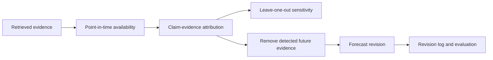

# FinLeakAudit

**Evidence-Level Temporal Leakage Audit and Forecast Revision for Financial
Agentic RAG**

FinLeakAudit is a controlled research pilot for measuring whether a financial
forecasting agent uses evidence that was unavailable at prediction time. It
checks point-in-time availability, traces explicit claim-evidence citations,
measures marginal forecast sensitivity, and revises forecasts after detected
future evidence is removed.

FinLeakAudit is **not** a new stock prediction model. The current repository is
an auditable engineering premise check, not a production trading system or a
finished benchmark.

## Research Problem

Financial Agentic RAG systems can retrieve a document after the historical
prediction cutoff while evaluating the resulting forecast as if that document
had already been available. This look-ahead leakage can inflate backtest
accuracy and produce convincing but temporally invalid rationales.

```text
prediction cutoff        post-cutoff disclosure          outcome
2024-02-21 16:00 ET      2024-02-21 16:22 ET             next close
        |                         |                           |
        | valid evidence          | future evidence           |
        +-------------------------+---------------------------+
```

Evidence is valid only when its availability time is no later than the
prediction cutoff:

```text
available_at <= prediction_cutoff
```

## Method



The current implementation separates predictor-visible information from audit
metadata. The predictor sees evidence IDs and text, but not timestamps,
availability labels, hand-written sentiment, or gold outcomes.

## Controlled Pilot

- **10 cases:** 7 controlled cases with real SEC filing sources and verified
  acceptance timestamps, plus 3 semi-real cases.
- **3 models:** DeepSeek `deepseek-chat`, Zhipu
  `glm-4-flashx-250414`, and local Qwen2.5-14B-Instruct Q4_K_M.
- **3 conditions:** Clean, Leaky, and Audited.
- **210 model calls:** 10 cases × 3 models × 7 calls, including
  leave-one-evidence-out ablations.
- **0 runtime errors** in the reported run.

Clean contains only pre-cutoff evidence. Leaky adds one post-cutoff item.
Audited starts from the actual Leaky context and removes only evidence IDs
returned by the auditor.

## Main Results

| Model | Future evidence cited | Clean-to-Leaky change | Recovered changes | Clean / Leaky / Audited accuracy |
|---|---:|---:|---:|---:|
| DeepSeek | 10/10 | 5/10 | 5/5 | 3/10 / 7/10 / 3/10 |
| Zhipu | 9/10 | 3/10 | 3/3 | 3/10 / 6/10 / 3/10 |
| Qwen2.5-14B | 9/10 | 4/10 | 4/4 | 2/10 / 5/10 / 2/10 |

Across 30 model-case runs:

- Future evidence was explicitly cited in **28/30** runs.
- The prediction category changed in **12/30** runs.
- All 12 changed predictions returned to their Clean category after detected
  future evidence was removed. This is **12/12 conditional recovery**, with a
  Wilson 95% interval of **[75.7%, 100%]**.
- Accuracy was **8/30 Clean**, **18/30 Leaky**, and **8/30 Audited**.

The Leaky accuracy increase is not a valid forecasting improvement. It is the
look-ahead inflation that the audit is designed to expose. Recovery means
restoring the pre-leak prediction category; it does not mean recovering the
correct market outcome.

Full results and uncertainty reporting:
[three-model v4 report](wiki/experiments/three_model_v4_results_2026_07_26.md).

## Baseline Comparison

The completed predictions also support an offline policy comparison:

| Policy | Accuracy | Future items retained | Direction changes vs No Audit |
|---|---:|---:|---:|
| No Audit | 18/30 (60.0%) | 30/30 | 0/30 |
| Timestamp-only | 8/30 (26.7%) | 0/30 | 12/30 |
| Citation-only | 8/30 (26.7%) | 2/30 | 12/30 |
| Delete-All-Future | 8/30 (26.7%) | 0/30 | 12/30 |

This is an important negative result: the current citation-only revision policy
does not outperform timestamp filtering on this controlled dataset, and it
misses two future items that were not explicitly cited. The planned research
contribution therefore depends on citation-free semantic attribution, uncertain
availability metadata, support/contradiction checks, and complete revision
logs. The repository does not label the current policy as Full FinLeakAudit.

See the [baseline report](wiki/experiments/baseline_comparison_v4_2026_07_26.md),
[policy summary](wiki/experiments/three_model_v4_baseline_summary_2026_07_26.csv),
and [30-row case table](wiki/experiments/three_model_v4_case_results_2026_07_26.csv).

## Implemented vs Planned

| Component | Status |
|---|---|
| Timezone-aware absolute timestamp comparison | Implemented |
| Predictor/auditor/evaluator information separation | Implemented |
| Explicit evidence-ID attribution | Implemented |
| Revision from Leaky context minus detected IDs | Implemented |
| Leave-one-out marginal sensitivity | Implemented |
| Three-model runner, retries, resume, and non-overwriting names | Implemented |
| Logic, metric, and v4 data validation tests | Implemented |
| Citation-free semantic attribution | Planned |
| Market-open and trading-calendar alignment | Planned |
| Original/revision/vendor timestamp handling | Planned |
| Support/contradiction operator evaluation | Planned |
| Natural point-in-time retrieval cases | Planned |

## Quick Start

The runner and tests use the Python standard library.

```bash
git clone git@github.com:yixi1120/FinLeakAudit-KB.git
cd FinLeakAudit-KB
python3 -m unittest discover -s tests -v
```

For cloud models, export keys in the shell. Do not commit them:

```bash
export DEEPSEEK_API_KEY="..."
export ZHIPU_API_KEY="..."
```

Run the mixed 10-case experiment:

```bash
python3 experiments/run_experiment.py \
  --model deepseek \
  --cases 数据线/cases_pilot_v4_mixed10_candidate.jsonl \
  --with-ablation \
  --run-name v4_mixed10_abs_time_20260726
```

Replace `deepseek` with `zhipu` or `qwen`. Qwen requires a local
OpenAI-compatible endpoint at `http://127.0.0.1:8080/v1`; see
[experiments/README.md](experiments/README.md).

Generate overall, tiered, and baseline summaries:

```bash
python3 experiments/analyze.py \
  --input experiments/results/deepseek_v4_mixed10_abs_time_20260726_ablation_results.jsonl \
  --output experiments/results/deepseek_v4_summary.csv

python3 experiments/analyze.py \
  --input experiments/results/deepseek_v4_mixed10_abs_time_20260726_ablation_results.jsonl \
  --output experiments/results/deepseek_v4_summary_by_tier.csv \
  --group-by dataset_tier

python3 experiments/analyze_baselines.py
```

Generated raw JSONL and CSV files under `experiments/results/` are ignored by
Git. Compact case-level outcomes and research reports are tracked in
`wiki/experiments/`.

## Reproducibility Record

| Item | Reported run |
|---|---|
| Experiment date | 2026-07-26 |
| Temperature | 0 |
| Base seed | 17, deterministically offset by case |
| DeepSeek model ID | `deepseek-chat` |
| Zhipu model ID | `glm-4-flashx-250414` |
| Local model | Qwen2.5-14B-Instruct GGUF Q4_K_M |
| Local inference backend | llama.cpp b10107 |
| Predictor metadata visibility | Evidence ID and text only |

`deepseek-chat` is a mutable provider alias. A paper-grade rerun should use an
immutable model version when available and record provider response metadata.

## Repository Guide

```text
experiments/        runnable pipeline and analysis
tests/              offline regression and data-validation tests
数据线/             pilot datasets and data-line review material
protocols/          audit operator specifications
wiki/experiments/   experiment designs, compact outputs, and reports
wiki/papers/        structured paper cards
wiki/concepts/      research concepts and terminology
matrices/           collision and comparison matrices
raw/                immutable source material
```

Start with:

- [v4 case construction](wiki/experiments/cases_pilot_v4_construction_2026_07_26.md)
- [three-model results](wiki/experiments/three_model_v4_results_2026_07_26.md)
- [baseline comparison](wiki/experiments/baseline_comparison_v4_2026_07_26.md)
- [research positioning](wiki/writing/research_positioning_2026_07_12.md)

## Limitations

1. The experiment contains only 10 controlled cases and one run per
   model-case.
2. The seven stronger cases use real sources and timestamps, but evidence was
   researcher-selected rather than naturally retrieved.
3. All seven stronger cases are earnings or financial-disclosure events.
4. Citation-only attribution misses semantic use without an explicit evidence
   ID.
5. The three semi-real cases contain synthetic Clean evidence.
6. Price directions were recomputed, but a second licensed market-data source
   is still needed for a paper-grade dataset.
7. The results do not establish how often leakage occurs in deployed financial
   RAG systems.

## Claim Boundary

The current evidence supports this description:

> A controlled pilot for measuring point-in-time evidence availability,
> rationale contamination, marginal forecast sensitivity, and leakage-driven
> revision in financial Agentic RAG.

It does not support claims of being the first financial-agent leakage study,
being a production benchmark, improving stock prediction accuracy, estimating
causal effects, or achieving universally perfect recovery.

## Maintainer

Maintained by [@yixi1120](https://github.com/yixi1120). Repository-visible
engineering, experiment, and documentation contributions can be verified in
the Git history and [research log](research_log.md).
