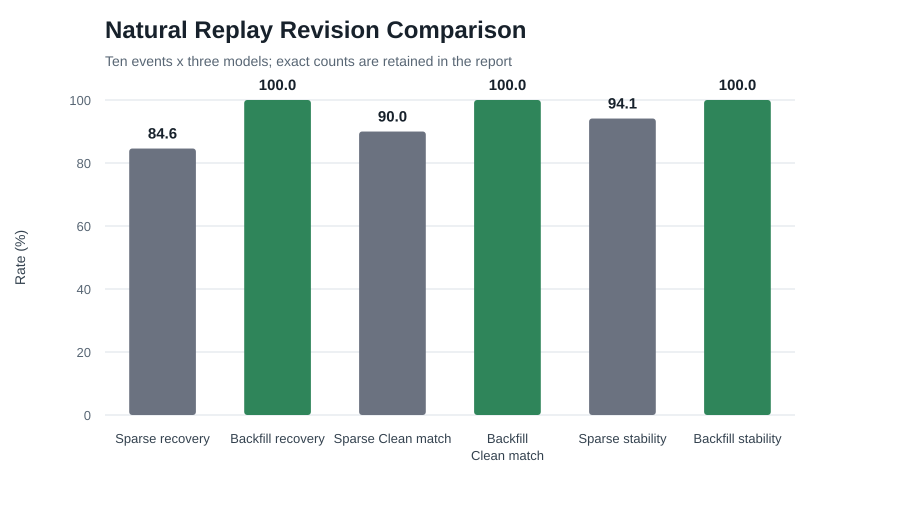

# Scope

This analysis joins two frozen five-event batches without rewriting their raw
results. Ten events were evaluated with DeepSeek, Zhipu, and local Qwen under
Clean, outcome-bounded Unfiltered, Sparse Audited, and rank-preserving Backfilled
Audited conditions. This remains a constructed primary-source candidate-feed stress
test, not a production retrieval trace or a leakage-prevalence estimate.

# Main result

Across 30 model-event runs and 120 retained predictions, future evidence was
explicitly cited in 27/30 Unfiltered runs and changed direction in 13/30.

Sparse deletion recovered 11/13 flips. Backfilled revision recovered 13/13 (100.0%; Wilson 95% interval 77.2%-100.0%). On 17 non-flipped runs, Sparse drifted in 1/17 and Backfilled in 0/17.

Overall, Sparse matched Clean in 27/30, while Backfilled matched Clean in 30/30 (Wilson 95% interval 88.6%-100.0%). The exact paired
McNemar p-value is 0.250; this sample therefore
does not establish a statistically reliable general advantage.



# Model summary

| Model | Runs | Future cited | Flips | Sparse recovery | Backfill recovery | Sparse drift / non-flips | Backfill drift / non-flips | Backfill = Clean |
|---|---:|---:|---:|---:|---:|---:|---:|---:|
| deepseek | 10 | 10/10 | 7 | 6/7 | 7/7 | 0/3 | 0/3 | 10/10 |
| qwen | 10 | 9/10 | 5 | 4/5 | 5/5 | 1/5 | 0/5 | 10/10 |
| zhipu | 10 | 8/10 | 1 | 1/1 | 1/1 | 0/9 | 0/9 | 10/10 |

# Cases corrected by Backfill

| Model | Event | Clean | Unfiltered | Sparse | Backfilled | Type |
|---|---|---|---|---|---|---|
| deepseek | natural_005 (INTC) | UP | DOWN | DOWN | UP | recovery failure |
| qwen | natural_006 (XOM) | NEUTRAL | UP | UP | NEUTRAL | recovery failure |
| qwen | natural_007 (COF) | UP | UP | NEUTRAL | UP | non-flip drift |

# Accuracy and citation integrity

Outcome accuracy was 36.7% Clean, 53.3% Unfiltered, 36.7% Sparse, and 36.7% Backfilled. The Unfiltered increase is
hindsight inflation and is not valid forecasting performance. Backfilled returns
to Clean accuracy because all Backfilled directions match Clean.

Citation validation found 30 invalid IDs
across 11/90 base-condition outputs and 8 invalid IDs across 3/30 Backfilled outputs. Errors were preserved rather than
silently normalized. They include shortened document IDs, fabricated IDs, headings
used as IDs, and valid IDs concatenated with filenames.

Backfilled evidence order exactly matched Clean in 24/30 runs. One Qwen event required a recorded event-level
retry after a transient timeout. Total retained-output usage was 869,364 tokens.

# Interpretation boundary

- The main result is revision consistency, not improved market accuracy.
- Backfill corrected three observed Sparse mismatches, but 24/30 Backfilled inputs
  were identical to Clean and the exact paired test is not significant.
- Timestamp validity does not guarantee evidence truthfulness or relevance.
- Invalid model-generated citation IDs remain an interface and attribution failure.
- The event set is purposive and too small for prevalence claims.

# Reproduce

```bash
python3 experiments/analyze_natural_10event.py
python3 -m unittest tests.test_analyze_natural_10event -v
```
