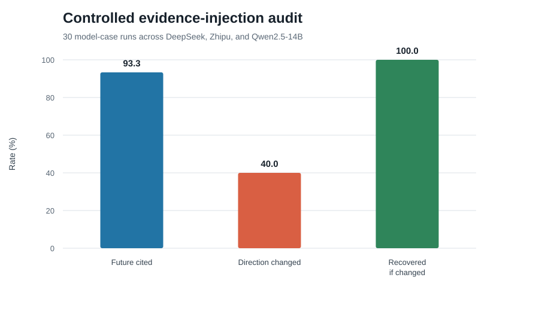
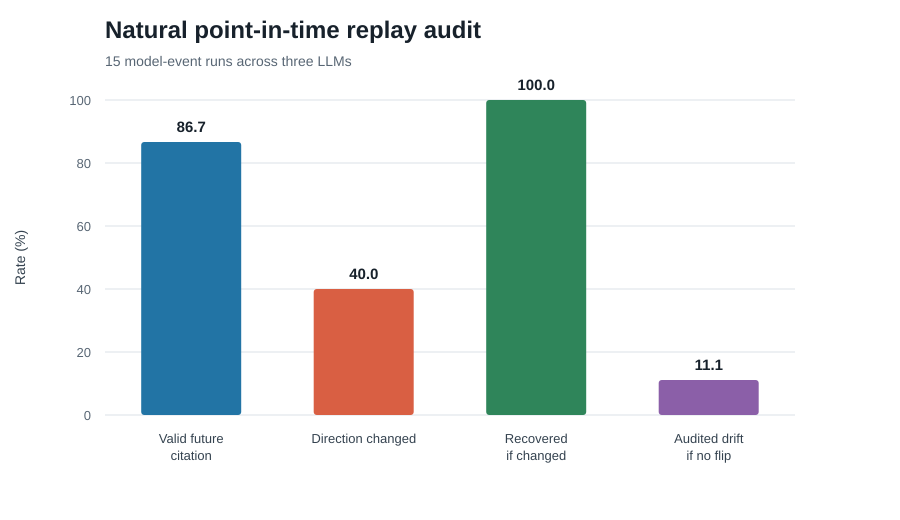
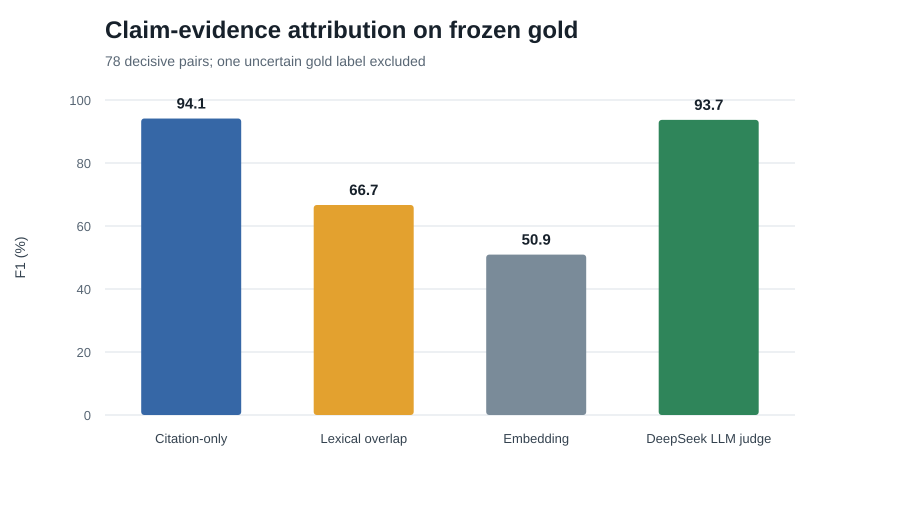

# Visible Result

The controlled study contains 30 model-case runs and 210 model calls. The natural replay currently contains 15 model-event runs and 45 prediction calls. The semantic benchmark contains 78 decisive gold pairs.

# Forecast Audit Metrics

| Study | Model | Runs | Valid future citation | Direction changed | Recovered changes | Audited drift without flip | Clean / contaminated / audited accuracy |
|---|---|---:|---:|---:|---:|---:|---:|
| controlled_injection | DeepSeek | 10 | 10/10 | 5/10 | 5/5 | 0 | 3/10 / 7/10 / 3/10 |
| controlled_injection | Zhipu | 10 | 9/10 | 3/10 | 3/3 | 0 | 3/10 / 6/10 / 3/10 |
| controlled_injection | Qwen2.5-14B | 10 | 9/10 | 4/10 | 4/4 | 0 | 2/10 / 5/10 / 2/10 |
| natural_replay | DeepSeek | 5 | 5/5 | 3/5 | 3/3 | 0 | 1/5 / 4/5 / 1/5 |
| natural_replay | Zhipu | 5 | 4/5 | 1/5 | 1/1 | 0 | 3/5 / 4/5 / 3/5 |
| natural_replay | Qwen2.5-14B | 5 | 4/5 | 2/5 | 2/2 | 1 | 2/5 / 4/5 / 1/5 |

# Semantic Attribution Metrics

| Attribution method | Precision | Recall | F1 | FP | FN |
|---|---:|---:|---:|---:|---:|
| Citation-only | 90.9% | 97.6% | 94.1% | 4 | 1 |
| Lexical overlap | 95.5% | 51.2% | 66.7% | 1 | 20 |
| Embedding similarity | 100.0% | 34.1% | 50.9% | 0 | 27 |
| DeepSeek LLM judge | 97.4% | 90.2% | 93.7% | 1 | 4 |

# Reading Rule

Recovery is conditional on a Clean-to-contaminated direction change and means that the
Audited prediction equals the Clean prediction. It does not mean the forecast became
correct. Contaminated accuracy is reported to expose hindsight inflation, not as a
performance improvement.

The prose-ready interpretation is maintained in
[`wiki/writing/results_draft_v1.md`](../writing/results_draft_v1.md).
